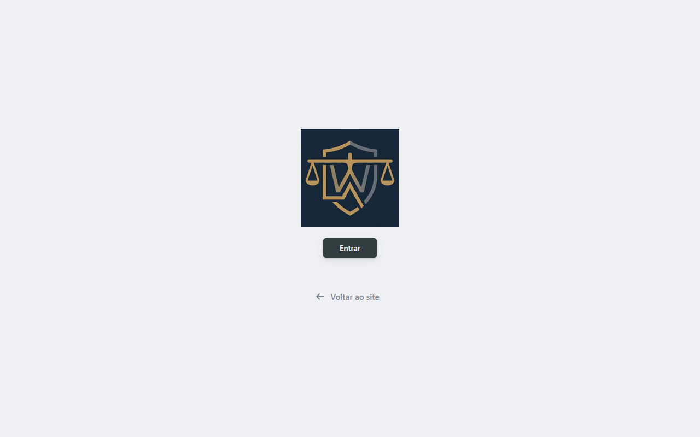
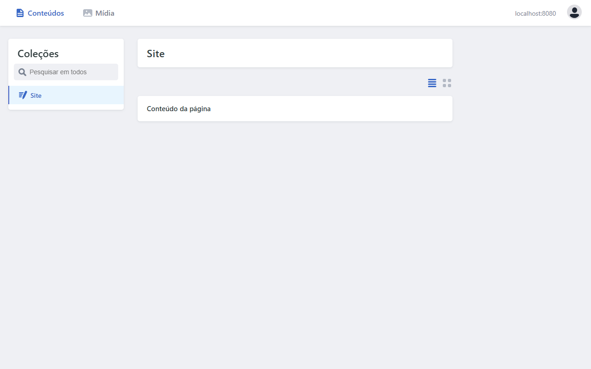
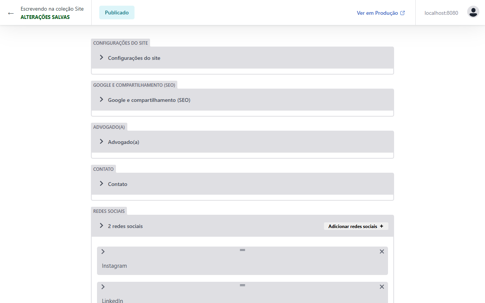
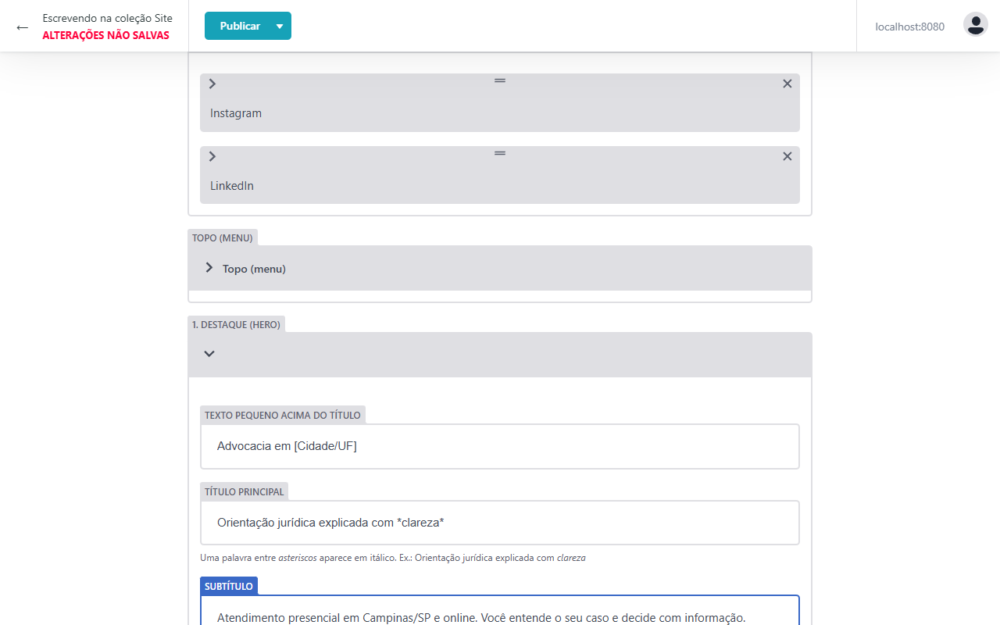
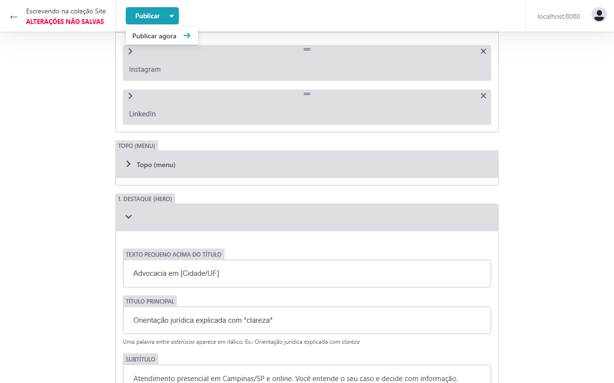
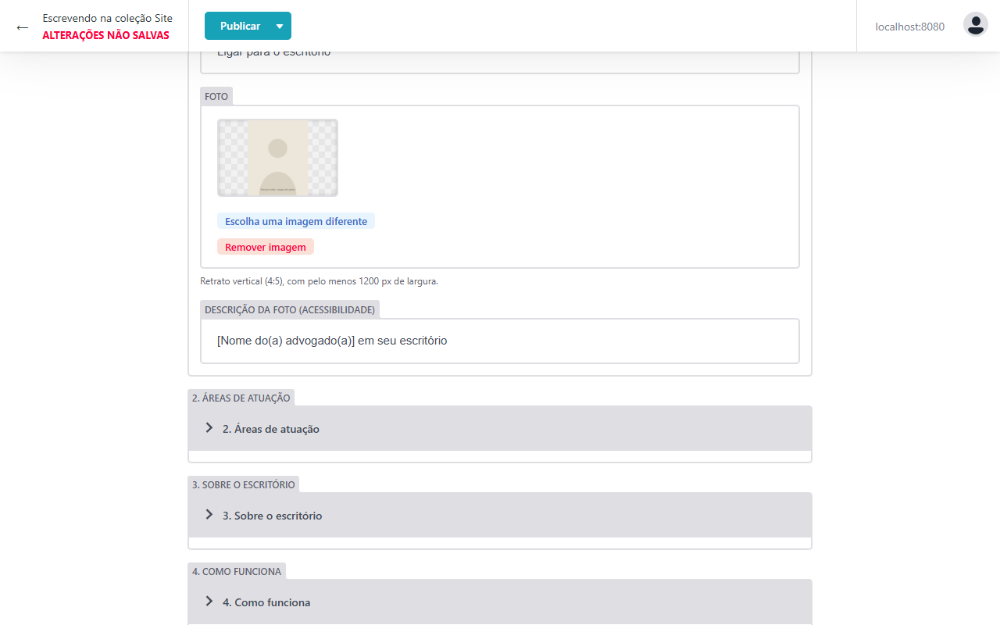
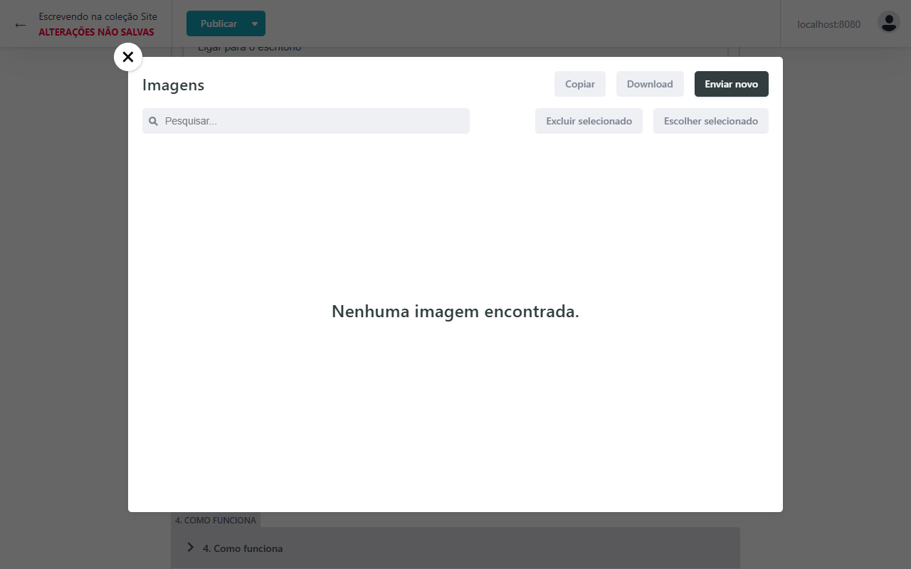

# Como editar o site pelo painel

Este guia mostra como trocar textos, fotos, telefone, áreas de atuação e perguntas do site **sem mexer em código**. O painel funciona no seu computador. Quando o site estiver publicado, ele passa a funcionar também pela internet (veja `publicacao.md`).

---

## Antes de começar (só na primeira vez)

1. Instale o **Node.js** (versão LTS) em https://nodejs.org: baixe, clique em "Avançar" até o fim.
2. Pronto. O resto é automático.

## 1. Abrir o painel

- **No Windows:** dê **dois cliques** no arquivo **`editar-site.cmd`**, na pasta do projeto. Uma janela preta se abre (deixe-a aberta) e o navegador abre o painel sozinho.
- **Em outro sistema, ou se preferir o terminal:** dentro da pasta do projeto, rode `npm run dev` e abra **http://localhost:8080/admin/**.

Clique em **Entrar**. Localmente, não há senha.

## 2. Abrir o conteúdo

Em **Coleções → Site**, clique em **Conteúdo da página**.

O conteúdo está dividido em blocos, na ordem em que aparecem no site:

| Bloco | O que tem dentro |
| --- | --- |
| Configurações do site | Endereço do site, ID do Google Tag Manager, URL do formulário e versão da política |
| Google e compartilhamento (SEO) | Título e descrição que aparecem no Google |
| Advogado(a) | Nome, **número da OAB**, formação e foto da seção Sobre |
| Contato | Telefone, WhatsApp, mensagem inicial do WhatsApp, e-mail, endereço, horário e mapa |
| Redes sociais | Instagram, LinkedIn etc. |
| Topo (menu) | Botão e links do menu |
| 1. Destaque (hero) | Título principal, subtítulo, botões e foto do topo |
| 2. Áreas de atuação | Os cards das áreas: nome, descrição e ícone |
| 3. Sobre o escritório | Texto de apresentação e diferenciais |
| 4. Como funciona | Os 4 passos do atendimento |
| 5. Perguntas frequentes | Perguntas e respostas |
| 6. Contato e formulário | Título do bloco de contato e todos os textos do formulário |
| 7. Rodapé | Aviso da OAB e links |
| Aviso de cookies | Textos do aviso de cookies |
| Política de Privacidade | Todas as seções da política |

Clique na **setinha** (›) ao lado do nome do bloco para abri-lo.

## 3. Editar um texto

1. Abra o bloco, por exemplo **1. Destaque (hero)**.
2. Clique no campo e escreva. Embaixo de alguns campos há dicas em cinza.
3. No **Título principal**, uma palavra entre `*asteriscos*` aparece em *itálico* no site. Use no máximo uma.

> No canto superior esquerdo aparece **ALTERAÇÕES NÃO SALVAS** em vermelho. Nada vai para o site antes de você publicar.

## 4. Salvar (publicar)

Clique em **Publicar → Publicar agora**.

O aviso muda para **ALTERAÇÕES SALVAS**. Com o `editar-site.cmd` (ou `npm run dev`) aberto, o site se atualiza sozinho em cerca de 1 segundo: abra **http://localhost:8080** e recarregue a página para conferir.

## 5. Trocar uma foto

1. Abra o bloco **1. Destaque (hero)** (foto do topo) ou **Advogado(a)** (foto do Sobre).
2. Clique em **Escolha uma imagem diferente**.

   

3. Na janela **Imagens**, clique em **Enviar novo** e escolha a foto no seu computador.

   

4. Clique na foto enviada e depois em **Escolher selecionado**.
5. Atualize também a **Descrição da foto**, que é lida por pessoas cegas e pelo Google. Exemplo: "Retrato de Ana Souza no escritório".
6. **Publicar → Publicar agora.**

**Como deve ser a foto:** vertical (formato retrato, proporção 4:5), com **pelo menos 1200 pixels de largura**, luz natural e fundo neutro ou do escritório. JPG ou PNG. Não precisa diminuir o arquivo: o site gera sozinho versões leves (AVIF e WebP) em três tamanhos.

## 6. Adicionar, remover ou reordenar itens

Valem para áreas de atuação, diferenciais, passos, perguntas, redes e seções da política:

- **Adicionar:** botão **Adicionar …** no topo da lista.
- **Remover:** o **×** no canto do item.
- **Reordenar:** arraste o item pelo **═** no meio da barra.
- **Abrir um item:** a setinha **›** à esquerda.

Nas **áreas de atuação**, escolha também o **Ícone**. As opções já seguem o padrão visual do site, sem martelo nem balança.

## 7. Regras da OAB (importante)

O site é **informativo** (Provimento 205/2021). Ao escrever:

- **Não use:** "melhor", "o mais experiente", "causa ganha", "garantia de resultado", "100%", "consulta grátis", preços, descontos, promoções, depoimentos de clientes, número de processos ou de casos ganhos.
- **Use:** linguagem neutra e explicativa. Exemplos de botões: "Fale com o escritório", "Envie seu caso para análise".
- **Mantenha** o nome do(a) advogado(a) e o número da OAB sempre preenchidos.

O site **confere isso sozinho**: se algum termo proibido for escrito, a janela preta mostra `check-oab: … ocorrência(s) proibida(s)`, com o trecho, e a publicação final é bloqueada (`npm run build` falha). Corrija o texto e publique de novo.

## 8. Encerrar

Feche a janela preta. O que você publicou está salvo no arquivo `content/site.json`.

---

## Dúvidas comuns

| Situação | O que fazer |
| --- | --- |
| A página do painel não abre | Confira se a janela preta está aberta e sem mensagens de erro. Feche e abra o `editar-site.cmd` de novo. |
| Publiquei e o site não mudou | Recarregue a página do site (Ctrl + F5). |
| Apareceu `check-oab` com erro | Um texto tem um termo proibido pela OAB. O aviso mostra qual e onde. |
| Quero desfazer uma alteração | Edite o campo de volta e publique. Se o projeto estiver no Git/GitHub, dá para recuperar qualquer versão anterior (veja `publicacao.md`). |
| A foto ficou cortada | O topo mostra a foto em 4:3 no celular e 4:5 no computador. Prefira fotos com o rosto no terço de cima e com espaço em volta. |
